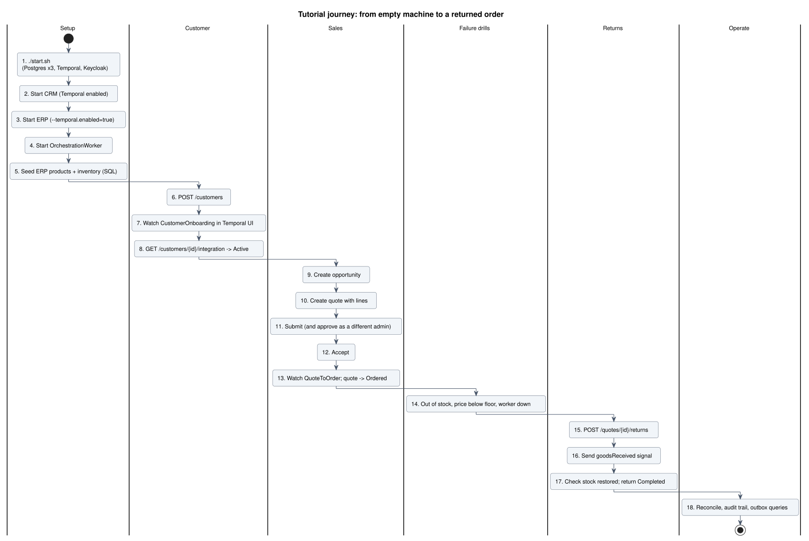
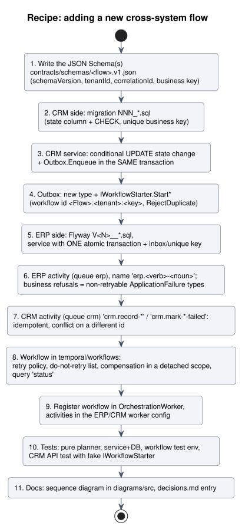

# Tutorial: running, exploring and extending the platform

This tutorial takes you from an empty machine to a customer onboarded into the ERP, a quote converted into an ERP order
with reserved stock, and a return that puts stock back. It then shows how to break things on purpose and how to extend the
platform. Architecture background is in [`README.md`](README.md); diagrams referenced here are in [`diagrams/`](diagrams).



> **Honest caveat.** The repository's own notes (`docs/decisions.md`, items 9 and 18-21) say the C# has never been compiled
> and the Spring and Temporal Java code has never been run. Expect to fix compile errors in step 2 to 4. Where a JSON field
> name below is inferred from the code rather than observed, it says so; adjust it to what your running API returns.

## Part 1. The mental model (10 minutes)

Hold five ideas and the rest of the code is easy to navigate.

1. **Two systems, two databases.** The CRM owns customers and quotes; the ERP owns orders and stock. They never share a
   database and never share IDs ([identifier ownership](diagrams/08-identifier-ownership.svg)).
2. **Temporal is the glue.** Three workflows run on the `orchestration` queue. They call *activities* on the `erp` queue
   (Java, in the ERP process) and the `crm` queue (C#, inside the CRM API process).
3. **The outbox starts workflows.** The CRM never calls Temporal inside a business transaction. It writes an
   `outbox_messages` row in the same transaction; a background publisher starts the workflow later
   ([outbox](diagrams/16-seq-outbox.svg)).
4. **Everything is safe to repeat.** Workflow ids are deterministic, ERP tables have unique business keys, status updates are
   conditional. Retrying is always allowed.
5. **The risky step is a plain database transaction.** Creating the ERP order and reserving stock happens in one SQL
   transaction; Temporal handles what happens before and after.

## Part 2. Prerequisites

| Tool | Version | Why |
|---|---|---|
| Docker with Compose | recent | Postgres x3, Temporal, Keycloak |
| .NET SDK | 10.0.100+ (`global.json`) | CRM |
| JDK | 21 for orchestration; 27 for the ERP (`erp/pom.xml`) | workflows and ERP |
| Maven | 3.9+ | Java builds |
| `curl`, `jq` | any | calling the API |
| Temporal CLI | optional | sending the `goodsReceived` signal |

NuGet and Maven Central must be reachable from your machine. The Foundgine packages are restored from `nuget-local/`.

## Part 3. Hands-on walkthrough

Run every command from the repository root unless stated.

### Step 1. Start the infrastructure

```bash
./start.sh
```

This copies `.env.example` to `.env` if needed and runs `docker compose up -d --wait`. When it finishes you have:
CRM DB :5433, ERP DB :5434, Temporal :7233 (UI http://localhost:8233), Keycloak http://localhost:8080.

Define two shortcuts for database access used throughout:

```bash
DC="docker compose --env-file .env -f infrastructure/docker-compose.yml"
crmsql() { $DC exec -T crm-db psql -U crm -d crm -c "$1"; }
erpsql() { $DC exec -T erp-db psql -U erp -d erp -c "$1"; }
```

### Step 2. Start the CRM

In a new terminal. A low approval threshold lets you see the approval flow with a small quote.

```bash
export ASPNETCORE_ENVIRONMENT=Development
export Temporal__Enabled=true
export Quotes__ApprovalThreshold=500
dotnet run --project crm/src/Crm.Api --urls http://localhost:5000
```

`appsettings.Development.json` supplies the connection string, turns on header-based dev authentication and applies the SQL
migrations at startup. `Temporal__Enabled=true` starts the outbox publisher and the CRM activity worker inside this process.

Check it: `curl -s localhost:5000/api/v1/health` should print `{"service":"crm","status":"ok"}`.

### Step 3. Start the ERP

```bash
mvn -f erp/pom.xml spring-boot:run -Dspring-boot.run.arguments=--temporal.enabled=true
```

Flyway creates the ERP schema (V1 to V3) and the ERP activity worker starts on queue `erp`.
`curl -s localhost:8082/api/v1/health`.

### Step 4. Start the orchestration worker

```bash
mvn -f temporal/workflows/pom.xml exec:java
```

You should see `Orchestration worker started on localhost:7233 ns=enterprise`. In the Temporal UI, open namespace
`enterprise` and the Workers view: you should see task queues `orchestration`, `crm` and `erp` all with pollers.

### Step 5. Seed the ERP catalogue

The ERP has no product endpoints yet, so insert rows directly (tenant `acme`):

```bash
erpsql "INSERT INTO erp_products (tenant_id, sku, name, list_price, min_unit_price) VALUES ('acme','SKU-1','Widget',100,80);"
erpsql "INSERT INTO erp_inventory (tenant_id, sku, on_hand) VALUES ('acme','SKU-1',50);"
```

The price floor of 80 matters later: quotes may discount, but not below the floor.

### Step 6. Authenticate (dev headers)

In Development the CRM accepts identity headers. Define two personas in your shell:

```bash
API=http://localhost:5000/api/v1
sales() { curl -s -H "Content-Type: application/json" -H "X-Tenant-Id: acme" -H "X-User-Id: alice" -H "X-Roles: crm-sales" "$@"; }
admin() { curl -s -H "Content-Type: application/json" -H "X-Tenant-Id: acme" -H "X-User-Id: dave"  -H "X-Roles: enterprise-admin" "$@"; }
sales $API/whoami | jq
```

> Prefer real tokens? Use the Keycloak users (password `dev-password`): alice crm-sales/acme, bob crm-support/acme,
> carol crm-admin/globex, dave enterprise-admin/acme.
> ```bash
> TOKEN=$(curl -s -d grant_type=password -d client_id=enterprise-web -d username=alice -d password=dev-password \
>   http://localhost:8080/realms/enterprise/protocol/openid-connect/token | jq -r .access_token)
> curl -s -H "Authorization: Bearer $TOKEN" $API/whoami | jq
> ```
> Header and token auth both work in Development (the header scheme is only chosen when `X-User-Id` is present).
> See [authentication](diagrams/15-seq-auth.svg).

### Step 7. Create a customer and watch onboarding

```bash
sales -X POST $API/customers -d '{"kind":"Business","name":"Acme Retail","email":"buyer@acme.example","phone":"+64 9 555 0100"}' | tee /tmp/cust.json | jq
CID=$(jq -r .id /tmp/cust.json)     # property name inferred from the code (Created($"/api/v1/customers/{c.Id}"))
```

What just happened ([sequence](diagrams/12-seq-onboarding.svg)): one transaction wrote the customer, a `Pending` mapping and an
outbox row. Within about two seconds the publisher started workflow `CustomerOnboarding:acme:<CID>`.

Observe it three ways:

```bash
crmsql "SELECT type, published_at IS NOT NULL AS published, publish_attempts FROM outbox_messages ORDER BY created_at;"
sales $API/customers/$CID/integration | jq          # status should become Active, with an ERP id such as ERP-9001
erpsql "SELECT erp_customer_id, crm_customer_id, name FROM erp_customers;"
```

In the Temporal UI, open the `CustomerOnboarding:acme:...` workflow: you will see the ERP activity then the CRM activity.
Note the two IDs: the CRM's integer and the ERP's own. Both systems keep their own.

### Step 8. Opportunity, quote, approval

```bash
sales -X POST $API/customers/$CID/opportunities -d '{"name":"Widget rollout","amount":900,"stage":"Prospecting"}' | tee /tmp/opp.json | jq
OID=$(jq -r .id /tmp/opp.json)

sales -X POST $API/opportunities/$OID/quotes \
  -d '{"lines":[{"sku":"SKU-1","description":"Widget","quantity":10,"unitPrice":90}]}' | tee /tmp/quote.json | jq
```

Read the quote id from the response (the quote record sits inside the returned view; look for the id field) and set it:

```bash
QID=<the quote id>
sales -X POST $API/quotes/$QID/submit | jq      # total 900 > threshold 500, so PendingApproval
sales -X POST $API/quotes/$QID/approve -o /dev/null -w "%{http_code}\n"   # alice is not an admin: expect 403
admin -X POST $API/quotes/$QID/approve | jq     # dave approves: Approved
```

See [quote lifecycle](diagrams/09-state-quote.svg). Segregation of duties is enforced: the approver must be an admin *and*
a different user from the submitter. Check the audit trail: `admin $API/audit | jq`.

### Step 9. Accept the quote and watch quote-to-order

```bash
sales -X POST $API/quotes/$QID/accept | jq
```

Accept requires the customer's mapping to be `Active` (step 7). In one transaction it marks the quote `Accepted`, closes the
opportunity as `ClosedWon` and queues a `QuoteAccepted` outbox message. Then ([sequence](diagrams/13-seq-quote-to-order.svg)):

```bash
sales $API/quotes/$QID | jq                      # status becomes Ordered, with erp_order_id (5001...)
erpsql "SELECT erp_order_id, crm_quote_id, total, status FROM sales_orders;"
erpsql "SELECT sku, on_hand, reserved FROM erp_inventory;"          # reserved = 10
erpsql "SELECT * FROM stock_reservations;"
```

Open workflow `QuoteToOrder:acme:<QID>` in the Temporal UI and compare its event history with the
[decision flow](diagrams/19-activity-quote-workflow.svg).

### Step 10. Failure drills

Each drill needs a fresh opportunity and quote. Use this helper:

```bash
newquote() {  # args: sku qty unitPrice -> prints the quote id after accepting
  local o q
  o=$(sales -X POST $API/customers/$CID/opportunities -d '{"name":"drill","amount":100,"stage":"Prospecting"}' | jq -r .id)
  sales -X POST $API/opportunities/$o/quotes -d "{\"lines\":[{\"sku\":\"$1\",\"description\":\"x\",\"quantity\":$2,\"unitPrice\":$3}]}" | jq
  echo "opportunity $o: read the quote id above, then submit/approve/accept it"
}
```

**Drill A: out of stock.** Quote 100 units of `SKU-1` (only 40 unreserved remain). After submit, approve and accept, the workflow
ends `Failed`; the quote moves `Accepted` to `OrderFailed` with the reason, and the ERP holds no order and no reservation:

```bash
sales $API/quotes/$QID2 | jq        # status OrderFailed, reason mentions stock
erpsql "SELECT count(*) FROM sales_orders WHERE crm_quote_id = $QID2;"    # 0
```

**Drill B: price below the floor.** Quote `SKU-1` at 70. The ERP refuses with `ValidationFailed` (floor 80); not retried; same
`OrderFailed` outcome.

**Drill C: a worker goes down.** Stop the orchestration worker (Ctrl+C in its terminal), accept a valid quote, and check
`crmsql "SELECT type, published_at FROM outbox_messages"`. The message is published (Temporal accepted the start) but the workflow just
waits. Restart the worker and it completes. Workflow state lives in Temporal, not in the worker.

**Drill D: Temporal is unreachable.** `$DC stop temporal`, accept a quote, and watch `publish_attempts` and `next_attempt_at` grow
with backoff. Start Temporal again: the row publishes. This is the outbox doing its job.

**Drill E: duplicates.** Call `accept` on the same quote twice. The second call is a conflict, and
`erpsql "SELECT count(*) FROM sales_orders GROUP BY crm_quote_id"` never shows more than 1.

### Step 11. Returns

```bash
sales -X POST $API/quotes/$QID/returns -d '{"reason":"Damaged in transit","lines":[{"sku":"SKU-1","quantity":3}]}' | jq
```

Read the return id from the response, then ([sequence](diagrams/14-seq-return.svg)):

```bash
sales $API/quotes/$QID/returns | jq            # Requested, then Authorized (with an ERP return id such as 7001)
```

The workflow `ReturnProcessing:acme:<returnId>` is now waiting up to 30 days for a signal. Tell it the goods arrived:

```bash
temporal workflow signal --namespace enterprise \
  --workflow-id ReturnProcessing:acme:<returnId> --name goodsReceived --input '{"receivedBy":"warehouse-1"}'
```

Then confirm: the CRM return is `Completed` and the ERP restocked once:

```bash
sales $API/returns/<returnId> | jq
erpsql "SELECT sku, on_hand, reserved FROM erp_inventory;"     # on_hand rose by 3
```

Try returning more than was ordered: the ERP records a `Rejected` decision (a business refusal, not a workflow failure) and the
CRM return becomes `Rejected` with a note. Note that anyone who can reach Temporal can send this signal; signal authorization is an open
item.

### Step 12. Operate it

| Task | How |
|---|---|
| Customers stuck in sync | `admin -X POST "$API/integration/reconcile?olderThanMinutes=15"`, see [recovery](diagrams/18-seq-reconcile.svg) |
| Outbox lag | `crmsql "SELECT count(*), min(created_at) FROM outbox_messages WHERE published_at IS NULL;"` |
| Failed quotes | `crmsql "SELECT quote_id, order_failure_reason FROM quotes WHERE status='OrderFailed';"` |
| Stuck returns | `crmsql "SELECT * FROM return_requests WHERE status='Requested' AND updated_at < now() - interval '1 hour';"` |
| Who did what | `admin $API/audit` (approve, reject, reconcile) |
| Traces | set `Telemetry__Enabled=true` and `OTEL_EXPORTER_OTLP_ENDPOINT`, see [tracing](diagrams/20-seq-tracing.svg) |

## Part 4. Code tour

| You want to understand | Start here |
|---|---|
| HTTP pipeline and DI | `crm/src/Crm.Api/Program.cs` |
| Endpoints and role policies | `crm/src/Crm.Api/Api/CrmEndpoints.cs` |
| Tenant scoping | `Application/TenantContext.cs` and any service in `Application/` |
| Quote rules | `Application/QuoteService.cs` |
| Outbox and publisher | `Integration/Outbox.cs`, `Integration/TemporalStarter.cs` |
| CRM activities | `Integration/CrmActivities.cs` |
| Schema | `db/migrations/001..006_*.sql` |
| Foundgine wiring | `Domain/CrmDomain.cs`, `Domain/CrmSemantics.cs`, `crm/foundgine/` |
| ERP order logic | `erp/.../order/ErpOrderService.java`, pure rules in `OrderPlanner.java` |
| ERP return logic | `erp/.../returns/ErpReturnService.java`, `ReturnPlanner.java` |
| ERP activities | `erp/.../integration/*ActivitiesImpl.java` |
| Workflows | `temporal/workflows/src/main/java/com/enterprise/orchestration/*WorkflowImpl.java` |
| Contracts | `contracts/schemas/*.json`, `Contracts.java` |
| Identity | `infrastructure/keycloak/enterprise-realm.json`, `docs/keycloak.md` |

## Part 5. Testing

| Suite | Command | Notes |
|---|---|---|
| CRM | `dotnet test crm/Crm.slnx` | DB-backed tests skip unless `CRM_TEST_CONNECTION="Host=localhost;Port=5433;Database=crm;Username=crm;Password=crm_dev_pw"` is set. Files: customer, authorization, JWT, quote, fulfilment, integration, reliability, health. |
| ERP | `mvn -f erp/pom.xml verify` | DB tests need `ERP_TEST_JDBC="jdbc:postgresql://localhost:5434/erp?user=erp&password=erp_dev_pw"`. Pure rules: `CustomerValidatorTest`, `OrderPlannerTest`, `ReturnPlannerTest`. |
| Workflows | `mvn -f temporal/workflows/pom.xml verify` | Temporal test environment; one test class per workflow. |
| CI | `.github/workflows/ci.yml` | jobs: crm, erp, orchestration, infra (compose config check). |

A good habit: write the **pure planner** first (no I/O), then the service with its SQL, then the activity, then the workflow.

## Part 6. Extending the platform

Follow the recipe; each step maps to code you have just seen.



Worked example, **order shipment status** (the next planned slice): define `ShipmentStatusChanged` with a version; add an
ERP shipment table and service; add an ERP activity that emits shipment facts; add an `OrderFulfilmentWorkflow` that calls
`crm.record-shipment` (already implemented on the CRM side, version-guarded); add a test that delivers the same message twice
and out of order. The CRM mirror and read endpoint (`GET /quotes/{id}/fulfilment`) already exist, so the first end-to-end proof
needs only the ERP half.

Rules of thumb that keep the design intact:
- Never call the other system's database or API from a service. Use a workflow and an activity.
- Never put a token or secret in an activity input.
- Business refusals are non-retryable failure types or recorded decisions; infrastructure failures are retried.
- Compensation goes in a detached cancellation scope so it runs even if the workflow is cancelled.
- Add a decisions entry saying what was verified and what was not.

## Part 7. Troubleshooting

| Symptom | Likely cause and fix |
|---|---|
| `dotnet` restore fails for `Foundgine.*` | `nuget.config` must keep the `nuget-local` source; run from the repo root |
| CRM starts but customers stay `Pending` | `Temporal__Enabled` not set, or orchestration/ERP worker not running; check queue pollers in the Temporal UI |
| Outbox rows never publish | Temporal not reachable on :7233; read `outbox_messages.last_error` |
| 401 with a Keycloak token | issuer or audience mismatch (`Auth:Authority`, audience `crm-api`), or `RequireHttpsMetadata` still true |
| 401 "Token has no tenant" | the user lacks the `tenant_id` attribute; service accounts have none by design |
| 403 on approve | caller is not admin, or is the same user who submitted |
| 404 on an id you just created | it belongs to a different tenant than your headers or token |
| 429 | per-tenant rate limit (`RateLimit:PermitsPerMinute`, default 600) |
| Workflow `Failed` with a stock message | expected for drill A; compare `erp_inventory` |
| Workflow stuck in `RecordingInCrm` | CRM worker down; CRM activities retry without limit, so it resumes when the CRM returns |
| ERP fails to build on Java 21 | `erp/pom.xml` targets release 27; use JDK 27 or change the pom deliberately (decisions item 1) |

## Part 8. Rendering and maintaining the diagrams

```bash
docs/architecture/render.sh                 # SVGs
docs/architecture/render.sh --png           # PNGs
PLANTUML_JAR=/path/plantuml.jar docs/architecture/render.sh   # without a plantuml command
```

Sources are `docs/architecture/diagrams/src/NN-name.puml` and share `_style.puml`. When you change behaviour, change the
matching sequence or state diagram in the same commit, and re-render. A CI step of `render.sh` followed by `git diff --exit-code`
keeps committed SVGs honest.
