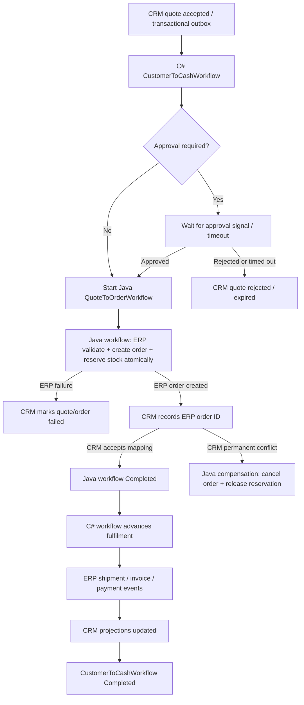

# Customer-to-Cash: Cross-language Temporal workflow

## Goal

Connect the existing CRM (.NET/Foundgine), ERP (Java/Spring/Foundgine), Java Temporal orchestration worker, and C# Temporal/Foundgine workflow worker into one durable business process.

This is the integration contract and implementation boundary for checkpoint 11 and the subsequent fulfilment increment. It deliberately preserves the existing Java `QuoteToOrderWorkflow` as the authority for the ERP order + stock-reservation transaction. It does not replace that implementation with a second order implementation.

## Workflow ownership

- CRM owns customer, opportunity, quote, and customer-facing projections.
- The C# workflow owns business coordination: approval gates, deadlines, customer communication state, and process-level status.
- The Java `QuoteToOrderWorkflow` owns the ERP order/reservation saga, including cancellation and reservation release if CRM rejects the order mapping.
- ERP owns authoritative customer, order, inventory, shipment, invoice, payment, and return records.
- Temporal owns durable execution, retries, signals, timers, workflow history, and worker recovery.

## Proposed workflow graph

## Workflow sequence

1. CRM commits quote acceptance and its outbox event in the same database transaction.
2. The outbox publisher starts `CustomerToCashWorkflow` with deterministic ID `CustomerToCash:{tenantId}:{quoteId}`. Duplicate delivery must be treated as success.
3. The C# workflow performs any required approval gate using a Temporal signal. Approval state is persisted in workflow history, not in process memory.
4. Once approved, the C# workflow starts the Java `QuoteToOrderWorkflow` with the existing `quote-accepted.v1` payload. The Java workflow remains the only component allowed to create the ERP order and reserve inventory.
5. The Java workflow creates the order and reserves inventory in one ERP database transaction. ERP validation, pricing, and stock failures are non-retryable business failures.
6. The Java workflow records the ERP order ID in CRM. Transient CRM outages retry. A permanent CRM conflict triggers the existing Java compensation path: cancel the ERP order and release stock.
7. The C# workflow advances only after the Java workflow reports `Completed`. It then waits for shipment, invoice, and payment events and coordinates their CRM projection updates.
8. CRM remains the customer-facing read model. ERP remains authoritative for operational and financial state.

## Cross-language contract rules

- Use the existing versioned JSON contracts under `contracts/schemas`.
- JSON is camelCase; timestamps are ISO-8601 UTC; monetary values are decimal strings or JSON numbers with explicit currency in the relevant business contract.
- Never pass access tokens, refresh tokens, Keycloak credentials, warrant material, or secrets in workflow arguments, memo, search attributes, or activity payloads.
- Every business payload includes `schemaVersion`, `tenantId`, and `correlationId`; quote/order flows also include stable business identifiers.
- Tenant identity is validated at the API boundary and propagated as an explicit immutable workflow field. Never accept a tenant switch from an untrusted activity payload.
- Workflow IDs are deterministic from tenant + business key. Activity effects are idempotent on tenant + business key.
- Do not use workflow state as a replacement for CRM/ERP persistence.

## Queue topology

| Queue | Worker | Responsibility |
|---|---|---|
| `crm-orchestration` | C# customer-to-cash workflow worker | Business-level workflow code only |
| `orchestration` | Java orchestration worker | Java onboarding, quote-to-order, return, and ERP-to-CRM projection workflows |
| `crm` | CRM activity worker | CRM reads/writes and projections |
| `erp` | ERP activity worker | ERP-owned transactional operations |
| `foundgine` | CRM Foundgine worker | Existing Foundgine process operations, including Keycloak administration |

The Java and C# workflow workers use separate workflow task queues. Temporal task queues do not provide workflow-type-based routing, so workers that register different workflow sets must not compete on the same queue. C# parent workflows poll `crm-orchestration`; Java child workflows poll `orchestration`. Activity queues remain separately owned by CRM (`crm`) and ERP (`erp`).

## Failure and compensation policy

| Failure | Required behavior |
|---|---|
| Duplicate outbox delivery | Same deterministic workflow ID; do not create a second business process |
| CRM/ERP temporary outage | Retry with bounded exponential backoff; retain workflow state |
| Invalid quote / insufficient stock | Non-retryable business failure; report to CRM |
| CRM permanently rejects ERP order mapping | Java workflow cancels ERP order and releases reservation |
| C# worker restart | Temporal replays workflow history; no in-memory state dependency |
| Approval timeout | Explicitly expire/reject according to CRM policy; do not silently continue |
| Shipment/invoice/payment event duplicated | Idempotent CRM projection update keyed by tenant + ERP event ID |
| Cross-service terminal failure | Preserve correlation ID and expose a reconciliation action; never silently swallow |

## Required implementation increments

### Increment A — C# workflow worker
- Add a typed C# `CustomerToCashWorkflow` and workflow contract.
- Register it on `orchestration`.
- Implement approval signal/query and deterministic workflow ID handling.
- Add a CRM outbox starter for this workflow.
- Add replay and workflow tests.

### Increment B — Java workflow hand-off
- Add a typed cross-language child-workflow contract for `QuoteToOrderWorkflow`.
- The C# workflow starts the Java workflow using the exact workflow type name and `quote-accepted.v1` payload.
- Verify Java/C# JSON serializer compatibility with golden contract vectors.
- Preserve Java compensation behavior and verify cancellation/retry semantics.

### Increment C — ERP and CRM lifecycle events
- Add ERP shipment, invoice, and payment event publication using transactional outbox.
- Add CRM idempotent event consumers/projection activities.
- Have the C# workflow wait on durable signals or child workflow completion, not polling loops.

### Increment D — End-to-end verification
- Start from CRM quote acceptance.
- Assert one customer mapping, one ERP order, one inventory reservation.
- Assert duplicate event delivery does not duplicate any effect.
- Inject CRM outage after ERP commit and verify retry.
- Inject permanent CRM mapping conflict and verify ERP compensation.
- Restart each worker during execution and verify completion.
- Verify tenant isolation and correlation propagation.

## Acceptance criteria

1. A quote accepted in CRM starts exactly one customer-to-cash workflow per tenant + quote.
2. Approval is durable and auditable.
3. The Java workflow remains responsible for atomic ERP order + reservation creation.
4. A successful workflow leaves CRM and ERP linked by the correct ERP order ID.
5. A permanent CRM rejection leaves no orphan ERP order or stock reservation.
6. Shipment, invoice, and payment state are reflected in CRM without making CRM authoritative for ERP state.
7. Java and C# workflow workers can be independently deployed and restarted.
8. No credentials or bearer tokens enter Temporal history.
9. Every activity is idempotent and tenant-scoped.
10. Automated tests cover retries, compensation, duplicate starts, worker restart/replay, and cross-language serialization.

## Important implementation note

This checkpoint already contains:
- CRM .NET integration activities and Temporal starter.
- Java `QuoteToOrderWorkflow` and its ERP/CRM activity contracts.
- ERP Java activity implementations and worker configuration.
- C# Foundgine Temporal process infrastructure in the Foundgine source archive.

Checkpoint 11 implements the C# customer-to-cash parent workflow and its Java child-workflow hand-off:
- CRM outbox now starts `CustomerToCashWorkflow` using deterministic ID `CustomerToCash:{tenantId}:{quoteId}`.
- `Crm.Worker` runs the C# workflow on `crm-orchestration` independently of the existing Foundgine process worker.
- The C# workflow supports an `approval` signal and `status` query. Approval-required workflows expire after 24 hours; rejection/expiry is reported through the existing CRM `crm.mark-order-failed` activity.
- On approval (or when approval is not required), C# starts Java `QuoteToOrderWorkflow` as a child on `orchestration`, using deterministic child ID `QuoteToOrder:{tenantId}:{quoteId}` and the exact version-1 quote payload.
- The parent reports `OrderCreated`, not `Completed`: fulfilment, invoice, and payment signals are still future work.

Current limitation: CRM outbox starts the workflow with `approvalRequired=false` because the current quote-accepted event has no approval-policy field. The approval signal is implemented for workflows started with the flag enabled, but a secured CRM approval-signal endpoint and the downstream fulfilment lifecycle are not yet included. The worker and project could not be built in this execution environment because the .NET SDK and Maven are unavailable; treat CI as the compile/test gate.

## Checkpoint 12 — fulfilment and cash lifecycle hand-off

The C# parent workflow remains open after the Java order child completes. It accepts three durable Temporal signals: `shipment`, `invoice`, and `payment`; each is applied through the existing CRM activities `crm.record-shipment`, `crm.record-invoice`, and `crm.record-payment`.

Signals received while the Java child is running are retained in Temporal history and drained after the child completes. The workflow rejects events for a different tenant or ERP order, applies only a strictly newer entity version, and relies on CRM's version-guarded upserts for duplicate/out-of-order protection.

The first vertical-slice completion gate is strict: at least one shipment exists and every current shipment version is `Delivered`; at least one invoice exists and every current invoice version is `Paid`; and reconciled payments cover each invoice total.

The ERP now has a transactional `erp_temporal_event_outbox` and a leased, retrying relay. ERP domain services can append shipment/invoice/payment payloads in the same transaction as their authoritative writes by calling `ErpTemporalEventOutbox.shipment`, `.invoice`, or `.payment`. The relay starts a deterministic Java `ErpCrmProjectionWorkflow` per ERP event, which applies the CRM activity with durable retries. It also signals `CustomerToCash:{tenantId}:{quoteId}` while that parent is still running so the C# workflow can evaluate completion. The projection workflow remains authoritative for CRM updates, including later payment reversals or tracking changes after the parent has completed. A crash after workflow start but before outbox acknowledgement causes safe redelivery because the projection workflow ID is deterministic.

**Scope boundary:** this increment supplies the event contract, durable relay, and C# lifecycle coordinator. It does not yet add ERP shipment/invoice/payment tables or operational APIs that create those records; future ERP domain writes must call the outbox methods. Therefore the workflow remains in `AwaitingFulfilment` until ERP emits all required lifecycle facts.

## Runtime configuration for checkpoint 12

Enable Temporal in the CRM API and ERP process, and run both workflow workers:

- CRM API: `Temporal__Enabled=true`, `Temporal__Address=<temporal-host>:7233`, `Temporal__Namespace=enterprise`, `Temporal__CrmTaskQueue=crm`.
- CRM worker: `Foundgine__Temporal__Address=<temporal-host>:7233`, `Foundgine__Temporal__Namespace=enterprise`, `Foundgine__Temporal__CustomerToCashTaskQueue=crm-orchestration`.
- ERP: `TEMPORAL_ENABLED=true`, `TEMPORAL_ADDRESS=<temporal-host>:7233`, `TEMPORAL_NAMESPACE=enterprise`, `TEMPORAL_ORCHESTRATION_TASK_QUEUE=orchestration`, `TEMPORAL_ERP_TASK_QUEUE=erp`.
- Java orchestration worker: `TEMPORAL_ADDRESS=<temporal-host>:7233`, `TEMPORAL_NAMESPACE=enterprise`, `TEMPORAL_ORCHESTRATION_TASK_QUEUE=orchestration`.

The Temporal frontend must be reachable only by trusted services and operators. Signal authorization is enforced by service network boundaries; never expose the Temporal frontend directly to end users.

## Checkpoint 14 — single-writer projection and retry semantics

The Java `ErpCrmProjectionWorkflow` is the sole writer for ERP shipment, invoice and payment projections in CRM. The C# `CustomerToCashWorkflow` receives the same versioned events only to maintain its customer-to-cash completion gate. This avoids double activity execution and keeps the Java projection workflow effective after the parent customer-to-cash workflow has completed.

ERP command idempotency now validates that a repeated key represents the same command payload. Reusing a shipment key with a different carrier/tracking value, or a payment key with a different amount/invoice, is rejected instead of silently returning the original resource. Repeating an already-applied shipment status transition is a successful no-op, covering HTTP retries after a lost response.
